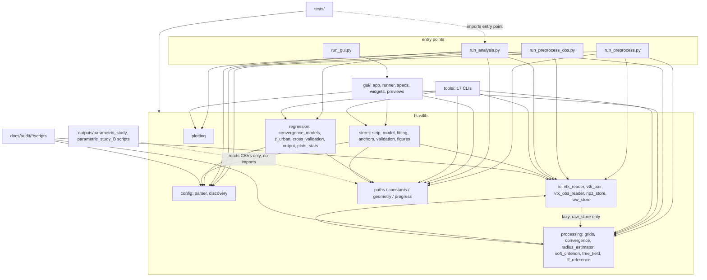

# Architecture review — compare_v7

Date: 2026-10-01. Read-only review; nothing in this document has been
executed. Per CLAUDE.md §1, every phase below is a **proposal** that requires
the owner's explicit approval (stated in Hebrew, with the affected results of
record) before any file is touched. This review wrote exactly one file: this
one.

Repo type: **research analysis repo** (thesis stages 3–4), not a desktop
application. It is judged against the target for such a repo: a core package
with pure numerics and no I/O in them, entry points that only orchestrate,
one folder per standalone tool, every output path defined once, results of
record separated from scratch output, and tests that pin the numbers.

---

## 1. Snapshot

- ~24,000 lines of Python: `blastlib/` 6,653; `tools/` 5,881 (17 tools);
  `gui/` 3,628; `tests/` 2,181 (19 files, 137 tests, 132 fast); analysis
  scripts under `outputs/` 3,153; frozen audit scripts under `docs/audit/`
  ~1,200; entry points ~1,000.
- Entry points: `run_preprocess.py` (VTK → NPZ), `run_preprocess_obs.py`
  (OBS surfaces), `run_analysis.py` (phase 1: convergence/MaxR tables;
  phase 2: cross-validated regression), `run_gui.py` (tkinter launcher).
- Frameworks: numpy/scipy/pandas/matplotlib/scikit-learn; tkinter only in
  `gui/` and two viewer tools (`tools/npz_viewer`, `tools/view_3d`).
- Overall shape: **already close to the target architecture.** `blastlib`
  is layered (config / io / processing / regression / plotting / street),
  imports no GUI or tool code, and has no `global` statements or
  module-level mutable state. `blastlib/paths.py` is a genuine single source
  of truth for every directory and carries the estimator-suffix rule
  (`suffixed()`). The GUI is thin by design: `gui/runner.py` does threading
  with zero tkinter imports, `gui/widgets.py` is widget-only, long runs go
  through `main(..., progress=)` off the main thread. Tools follow the
  `main(**kwargs)` + `cli()` convention almost uniformly. Results of record
  are tracked in git and guarded by anchor tests (`test_npz_anchors.py`,
  `test_street_anchors.py`) plus parity/gate reports. The remaining
  weaknesses are concentrated in two places: the phase-1 measurement chain
  living inline in the entry point, and the phase-2 regression having no
  fast characterisation test.

## 2. Dependency map



- **No circular imports at module level.** The one package-level inversion,
  `io/raw_store.py` → `processing/grids.py`, is a lazy in-function import
  with an explanatory comment (`blastlib/io/raw_store.py:177-181`); it does
  not cycle at import time.
- **No GUI-to-core leakage.** tkinter appears only in `gui/*`, `run_gui.py`,
  `tools/npz_viewer`, `tools/view_3d` (interactive viewers — acceptable for
  tools). No `blastlib` module imports `gui` or `tools`.
- **Two arrows against the grain:** `tests/` imports the entry point
  `run_analysis` (`tests/test_figure_selection.py:5`,
  `tests/test_maxr_consistency.py:144`), and `docs/audit/*/scripts` import
  live `blastlib`. Both are findings below.

## 3. Findings

Positive facts first, so the plan does not fix what is not broken: paths and
suffix handling centralised in `blastlib/paths.py`; one radius estimator
deliberately driving both `R_conv` and `MaxR` (resolved once in
`run_phase1`, as the docstring says); `rho`/`exclude_radius` geometry
centralised in `blastlib/geometry.py`; rationale comments in
`blastlib/constants.py` intact and cross-referenced; data-dependent tests
skip cleanly; `run_phase2` is already a thin orchestrator (run_analysis.py:430-471).

### F1 (high) — the phase-1 per-config measurement chain lives inline in the entry point
- Location: `run_analysis.py:82-427` (`run_phase1`, 346 lines; the
  per-config loop from line 201 does the actual measurement: geometry,
  `concat3`, soft weights, `find_convergence_radius`, per-theta MaxR scan,
  row assembly).
- Problem: the chain that produces the thesis's primary tables is not an
  importable function. The anchor tests say so themselves —
  `tests/test_npz_anchors.py:1-6`: *"The chain below replicates
  run_analysis.run_phase1 per-config computation exactly"*. Every anchor
  therefore tests a **hand-copied replica** of the production chain, not the
  production chain. A future edit to `run_phase1` that the replica does not
  mirror would leave the anchors green while the record moves — the exact
  failure mode the anchors exist to prevent. The same forces
  `tests/test_maxr_consistency.py:144-152` to pin a call-site property via
  `inspect.getsource(run_analysis.run_phase1)` string-splitting.
- Why it matters here: thesis reproducibility rests on these anchors; the
  replica is the single weakest link in the verification story (§4 of
  CLAUDE.md, direction 4).

### F2 (high) — phase 2 has no fast characterisation test
- Location: `blastlib/regression/cross_validation.py:39-367`
  (`run_cross_validation`, one 329-line function); consumers
  `run_analysis.py:430`, `tools/logo_cv`, `tools/pressure_report`.
- Problem: the production fits (`final_production_*.csv`, `cv_summary*.csv`
  — results of record) are reproducible only by the ~30-min production run
  followed by a git diff. `tests/test_regression_models.py` covers the model
  formulas and `tests/test_z_urban_domain.py` the domain mask, but nothing
  pins the end-to-end regression (split sequence, selection, coefficient
  output) at a cheap `n_iter`. A refactor or a scikit-learn upgrade (README
  §4 trap) would be detected late and expensively.
- Why it matters: this is the only stage of record without an anchor-grade
  guard; `random_state=42` and `StratifiedShuffleSplit` make a small pinned
  run deterministic and cheap (the `--n-iter 20` smoke run already exists as
  a sanctioned command, CLAUDE.md §5).

### F3 (medium) — tools/z_surface_3d duplicates both coefficients and model formula
- Location: `tools/z_surface_3d/z_surface_3d.py:28-46` — the `COEF` dict
  (known trap, CLAUDE.md §8, reported as known) **and** the inline `Zp()`
  closed form, which re-implements the production convergence model that
  lives in `blastlib/regression/convergence_models.py`.
- Problem: beyond the documented stale-coefficients trap, a change to the
  model *form* in `convergence_models.py` would silently desynchronise this
  tool's figures from the record. Nothing automated compares them.
- Why it matters: figures from this tool may appear in the thesis; a
  skip-if-absent parity test closes the trap without touching the tool.

### F4 (medium) — estimator-suffix pinning is correct but scattered, with no registry
- Locations: production token `req_soft3` in
  `blastlib/constants.py::RADIUS_ESTIMATOR`; hard-pinned `_req` consumers at
  `gui/matched_preview.py:40` (`TABLE_NAME = 'convergence_table_req.csv'`),
  `gui/specs.py:336`, `outputs/parametric_study/_common.py` and
  `outputs/parametric_study_B/_common.py:34-38` (four table paths),
  `tools/soft_beta_scan/soft_beta_scan.py:12`,
  `tools/validate_npz_v2/validate_npz_v2.py:14`.
- Problem: each pin is individually deliberate and documented (e.g.
  parametric_study_B's docstring: "Only the current `_req` tables are
  read"), but there is no single place that lists which consumer reads which
  suffix and why. The suffix rule in CLAUDE.md §3 ("never compare tables with
  different suffixes") is enforced only by these local comments. If the
  production estimator ever changes again, finding every pin is a manual
  hunt.
- Why it matters: mixing `_req` and `_req_soft3` tables in one argument is
  the most likely silent-wrong-number failure in this repo.
- **Not proposed:** changing which table any consumer reads. Whether the
  matched-set views and parametric studies *should* stay on `_req` is an
  open question for the owner (§6), not a defect.

### F5 (medium) — ~3,150 lines of analysis code live inside `outputs/`, with two parallel `_common.py`
- Locations: `outputs/parametric_study/` (12 section scripts +
  `_common.py`, 399 lines) and `outputs/parametric_study_B/`
  (`_common.py`, 530 lines + sections); each section does
  `sys.path.insert(0, ...parents[1]); import _common`
  (e.g. `outputs/parametric_study/08_pi_groups/make_section.py:15-16`).
- Problem: code and generated artefacts share the results-of-record tree;
  the two `_common.py` modules overlap (CSV loaders for the same four
  tables, matched-set grouping) while deliberately differing in philosophy
  (tree B imports nothing from blastlib, measured data only). The repo
  convention everywhere else is "tools/ has the code, outputs/ has the
  products".
- Why it matters: `grep`/refactors over "the code" miss `outputs/`; a naive
  outputs/ cleanup could delete source; the duplication invites the two
  trees' table-parsing to drift apart.
- Mitigating fact: both trees are self-documented as standalone and
  read-only toward the rest of the repo; their products may already be cited.
  Relocation is therefore a **deferred, owner-gated** phase (see §5).

### F6 (low) — entry-point convention deviations in two tools
- Locations: `tools/soft_beta_scan/soft_beta_scan.py:66`
  (`main(progress=print)`, no `cli()`),
  `tools/validate_npz_v2/validate_npz_v2.py:65` (same);
  `tools/npz_viewer/npz_viewer.py:95` (`cli()` takes no `argv`).
- Problem: CLAUDE.md §7 requires `main(**kwargs)` + `cli()`; these three
  are the only deviations among 17 tools and 4 entry points. Minor, but the
  GUI/spec layer (`gui/specs.py`) assumes the convention.

### F7 (low) — io↔processing inversion handled by lazy import
- Location: `blastlib/io/raw_store.py:177-181` (lazy import of
  `blastlib.processing.grids`, with comment "Imported lazily so blastlib.io
  stays importable without the processing layer").
- Problem: criteria application at load time means the io layer calls the
  processing layer. It is deliberate (the v3 raw-store design moves criteria
  to analysis time) and documented; recorded here so no future cleanup
  "fixes" the lazy import by moving the criteria back into preprocessing.
  Document-only; no change proposed.

### F8 (low) — frozen audit scripts import live blastlib
- Location: `docs/audit/2026-09-27/scripts/*.py`,
  `.../2026-09-28/scripts/*.py`, `.../2026-09-30/scripts/*.py` (10 scripts).
- Problem: these document decisions at a moment in time (D2b, D31, D34,
  D35) but import today's `blastlib`; any core refactor can silently break
  their re-runnability, and re-running them against changed code would not
  reproduce the numbers in the audit reports anyway.
- Why it matters: thesis-defence traceability. Cheapest guard: a one-line
  header in each script naming the commit it ran against (several audit
  reports already do; the scripts themselves mostly do not). Owner decision.

### F9 (low) — stray files at repo root and docs root
- `blast_calculator.html` (tracked, repo root): a standalone Hebrew HTML
  calculator unrelated to the pipeline; candidate to move under `tools/` or
  `docs/`, owner decision (CLAUDE.md §1.6 — listed as candidate only).
- `docs/IATG-02.20-...-V.3.pdf` (untracked, per git status): duplicate of
  the tracked `docs/references/IATG-02.20-...pdf`. Candidate for deletion of
  the untracked copy; owner decision.

### F10 (informational) — test-coverage profile vs. the record
- Well covered: processing (convergence, soft criterion, grids merge,
  impulse criterion, raw store, free-field/MaxR consistency), street (model,
  strip, anchors, parity, master curve, smoothing, validation), regression
  model formulas, z_urban domain mask, GUI wiring/specs.
- Not covered: `regression/cross_validation.py` end-to-end (F2),
  `regression/output.py` (coefficient CSV writer — its products are of
  record), `plotting/*` (figures are declared not of record — acceptable),
  `config/discovery.py`, `io/vtk_obs_reader.py` (OBS side pipeline).

## 4. Target architecture

The current layout **is** the target; no re-foldering is needed. The target
state differs from today only in these respects:

```
compare_v7/
├─ run_preprocess.py / run_preprocess_obs.py / run_analysis.py / run_gui.py
│    └─ orchestration only: resolve paths, loop, progress, write CSVs
├─ blastlib/
│  ├─ config/  io/  plotting/  street/           (unchanged)
│  ├─ processing/
│  │   └─ pipeline.py        ← NEW: measure_config(...) — the per-config
│  │                            chain extracted verbatim from run_phase1;
│  │                            the ONLY importable definition of the
│  │                            phase-1 measurement
│  ├─ regression/            (cross_validation internally sectioned, same order)
│  └─ paths.py               + a short consumer/suffix registry comment
├─ tools/                    (unchanged; every tool main(**kwargs)+cli())
├─ gui/                      (unchanged — already thin)
├─ tests/
│  ├─ test_npz_anchors.py    ← calls blastlib.processing.pipeline directly
│  ├─ test_phase2_smoke.py   ← NEW: pins phase-2 at n_iter=20 (F2)
│  └─ test_z_surface_parity.py ← NEW: COEF/formula vs CSV + model (F3)
├─ outputs/                  (results of record; parametric_study trees stay
│                             until the owner rules on F5)
└─ docs/                     (unchanged)
```

Invariants that must survive every phase untouched: all results of record
(§3 of CLAUDE.md), every rationale comment in `blastlib/constants.py`, every
formula/threshold/coefficient/criterion, the thesis-notation names, the
estimator-suffix semantics, public `main(**kwargs)` signatures, CSV column
layouts and float formatting, and `blastlib/street` (parity-pinned at
max|Δ|=0 — do not reorder its arithmetic).

## 5. Migration plan

General rules. Each phase is a few hours, leaves `python -m pytest -q -m
"not slow"` green and `run_gui.py` launchable, and names its verification.
Baseline comparison for any regenerated table follows the known 1-ulp drift:
compare at rel 1e-12 against the tracked CSVs, never bit-exact
(tools/validate_migration/compare_outputs.py already does rtol/atol
comparison and can serve as the comparator). "No record moves" means: the
tracked CSVs under `outputs/tables` and `outputs/check_results` are not
rewritten by the phase; where a phase regenerates tables *for comparison*,
it does so into a scratch `--tables-dir` outside `outputs/`.

**Phase 0 — lock the numbers (prerequisite for everything).**
- Goal: characterisation coverage for the one unguarded stage of record.
  Git is already initialised and the phase-1/street anchors already exist;
  the gap is phase 2.
- Files touched: new `tests/test_phase2_smoke.py` only.
- What it does: run `run_phase2(tables_dir=<tmp copy of the two tracked
  phase-1 CSVs>, n_iterations=20, ...)` with production `model_p/model_i`,
  into a temp dir; pin the resulting coefficient CSV values (captured once,
  reviewed by the owner) at rel 1e-12; mark `slow` if it exceeds ~1 min.
  Explicitly annotate: comparable only at `n_iter=20` (CLAUDE.md §8 trap).
- Must NOT change: anything outside `tests/`; no tracked table is written.
- Verification: new test green twice in a row (determinism); fast suite
  green; anchors not skipped (data present locally).
- Record risk: none — read-only with respect to `outputs/`.

**Phase 1 — extract the phase-1 per-config chain (F1).**
- Goal: make the measurement chain importable so anchors test production
  code, not a replica.
- Files touched: `run_analysis.py`, new `blastlib/processing/pipeline.py`.
- What moves: the body of the per-config iteration in `run_phase1`
  (run_analysis.py:≈201-380: parse → load → geometry → concat3 → soft
  weights → `find_convergence_radius` → per-theta MaxR rows), moved
  **verbatim, preserving statement order**, into
  `pipeline.measure_config(processed, cfg, est, ff_lookup, ...) -> rows`.
  `run_phase1` keeps discovery, progress, figure dispatch, CSV writing, and
  its public signature and return dict.
- Must NOT change: any arithmetic or its order (a pure cut-and-paste move
  reorders no floating-point operation); `run_phase1`'s signature; CSV
  contents and formatting; figure output.
- Verification: (a) fast suite green; (b) regenerate
  `convergence_table_req_soft3.csv` and `max_radius_per_Z_req_soft3.csv`
  into a scratch dir and compare to tracked at rel 1e-12; (c) GUI phase-1
  screen starts. Tracked files untouched.
- Record risk: none if (b) passes; if (b) fails the phase is reverted, per
  CLAUDE.md §1.3.

**Phase 2 — retarget the anchor and source-inspection tests (F1, second half).**
- Goal: delete the hand-copied replica risk.
- Files touched: `tests/test_npz_anchors.py` (call
  `pipeline.measure_config` instead of replicating the chain; anchor
  constants unchanged), `tests/test_maxr_consistency.py:144-152` (point
  `inspect.getsource` at the extracted function so the exclude_r guard
  keeps biting).
- Must NOT change: any anchor value; the property each test pins.
- Verification: full fast suite green with data present (anchors not
  skipped); deliberately breaking `exclude_r` in a scratch copy still trips
  the guard.
- Record risk: none (tests only).

**Phase 3 — z_surface_3d parity guard (F3).**
- Goal: automate the CLAUDE.md §8 trap.
- Files touched: new `tests/test_z_surface_parity.py` only. The tool itself
  is NOT edited (whether it should read the CSV instead of hard-coding is an
  owner decision, §6).
- What it does: skip-if-absent read of
  `outputs/tables/final_production_convergence_coefficients_req_soft3.csv`;
  assert the `COEF` dict matches the CSV rows, and assert `Zp()` agrees with
  the corresponding `blastlib.regression.convergence_models` prediction at a
  handful of sample points (rel 1e-9).
- Verification: test green against the current record; fast suite green.
- Record risk: none.

**Phase 4 — suffix/consumer registry (F4).**
- Goal: one place that says which consumer reads which estimator token.
- Files touched: `blastlib/paths.py` (a comment block or small dict of
  named table constants, e.g. `MATCHED_SET_TABLE = 'convergence_table_req.csv'`
  with the rationale), `gui/matched_preview.py:40`, `gui/specs.py` — the
  string literals become references to the named constants. The
  `outputs/parametric_study*` `_common.py` files are NOT touched (they are
  deliberately standalone; the registry lists them as external pins).
- Must NOT change: which file any consumer opens (byte-identical resolved
  paths — assert in a quick scratch check before/after).
- Verification: fast suite incl. `test_gui_specs_soft` green; launch the
  matched-sets GUI screen and confirm it renders from the same table.
- Record risk: none.

**Phase 5 — tool convention cleanup (F6).**
- Goal: uniform `main(**kwargs)` + `cli(argv=None)`.
- Files touched: `tools/soft_beta_scan/soft_beta_scan.py`,
  `tools/validate_npz_v2/validate_npz_v2.py`, `tools/npz_viewer/npz_viewer.py`
  — add/normalise `cli()` wrappers around the existing `main`s; no logic
  change.
- Must NOT change: `main` behaviour, any output file, any default.
- Verification: each tool's `--help` runs; `soft_beta_scan` and
  `validate_npz_v2` dry behaviour unchanged (both only read NPZ and write
  under `outputs/check_results` — do not actually re-run them; a `--help`
  and import check suffices, plus fast suite green).
- Record risk: none.

**Phase 6 — hygiene candidates (F8, F9), each item individually owner-approved.**
- Goal: remove ambiguity at the roots.
- Candidate actions (NOT bundled; the owner picks): delete the untracked
  duplicate `docs/IATG-02.20-...pdf`; relocate `blast_calculator.html`;
  add a "ran against commit <hash>" header line to each
  `docs/audit/*/scripts/*.py`; add one README §6 line placing
  `run_preprocess_obs.py` and the OBS store in the layout table.
- Verification: `git status` clean apart from the intended moves; fast
  suite green; no Python file's content changes except the added comment
  headers.
- Record risk: none.

**Deferred (not scheduled) — relocating `outputs/parametric_study*` code (F5).**
Moving the section scripts to `tools/` with byte-identical regenerated
artefacts is feasible (each script is deterministic over tracked `_req`
CSVs), but the trees' products may already be cited in thesis drafts and the
two `_common.py` modules differ by design, not by accident. This should not
be attempted before the owner states whether those studies are frozen
deliverables or living code. Until then the registry of Phase 4 simply
documents them.

**Explicitly not proposed, ever, by this review:** any change to
`blastlib/constants.py` or its rationale comments; any formula, threshold
(10 kPa band, `thr_I_scaled = 20`, `beta = 3`, `MAX_HEIGHT = 24`),
coefficient, criterion or `random_state`; any edit inside `blastlib/street`
(parity-pinned); splitting `run_cross_validation` into stages (its 329 lines
are ugly but any internal reordering risks touching the floating-point
stream that produced the production fits — not worth it while Phase 0's
smoke test does the guarding); any change to NPZ schemas or CSV layouts;
dropping beyond-radius rows from `max_radius_per_Z_*.csv` (CLAUDE.md §8);
renaming thesis-notation variables.

Estimate: 7 scheduled phases (0–6), each a few hours; Phases 0–3 deliver
most of the risk reduction and are independent of 4–6.

## 6. Open questions for the author

1. **`_req` vs `req_soft3` consumers (F4).** The matched-set GUI screens and
   both parametric-study trees pin `_req` tables while production is
   `req_soft3`. Is that a deliberate, permanent choice (the studies were
   designed on the hard-criterion record), or should they migrate once the
   `req_soft3` record is final? The review assumes deliberate and changes
   nothing.
2. **`outputs/parametric_study*` status (F5).** Are these trees frozen
   deliverables (their figures/markdown already cited in the thesis draft) or
   living analysis code? This decides whether the deferred relocation phase
   ever runs.
3. **z_surface_3d (F3).** Should the tool keep the hard-coded `COEF` (with
   the new parity test as the guard), or read
   `final_production_convergence_coefficients_req_soft3.csv` at runtime? The
   hard-coding comment suggests the by-hand update is intentional.
4. **Phase-2 smoke anchor values (Phase 0).** The pinned n_iter=20 numbers
   must be generated once and approved by the owner before the test exists —
   which machine/scikit-learn version is the reference? (README §4 names
   scikit-learn upgrades as the first suspect for Phase-2 drift.)
5. **OBS pipeline.** `run_preprocess_obs.py` / `io/vtk_obs_reader.py` /
   `tools/view_3d --obs` have no tests. Is the OBS (building-surface) branch
   still on the thesis path, or dormant? That decides whether F10's gap is
   worth closing.
6. **Audit scripts (F8).** Should each frozen audit script carry the commit
   hash it ran against, or is the audit report's own hash reference
   sufficient?
